<div align="center">

# RouteVoice

### Speech → Silicon · Version 1 milestone

**A speech-recognition transformer compiled into hardwired-weight logic.<br>Built with open tools. Laid out in 180 nm. Documented from audio to GDS.**

[**Explore the helmet website ↗**](https://routing-module-180.vercel.app) · [**Try the browser models ↗**](https://routing-module-180.vercel.app/models) · [**Watch the explainer ↓**](#watch-speech--silicon) · [**Read the paper ↗**](paper/RouteVoice-paper-draft.pdf)

<a href="https://routing-module-180.vercel.app">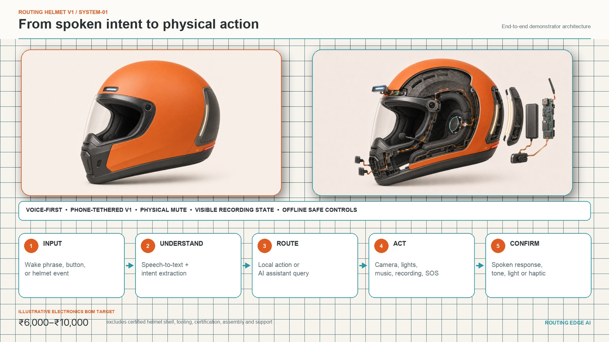</a>

*The helmet is the product vision. RouteVoice is the speech-hardware research behind it.*

</div>

RouteVoice asks a practical question: **what if a small voice model became part of the chip itself?** Instead of repeatedly fetching millions of weights from external memory, it represents fixed model weights through compact codebooks and mask-programmed selections, then reuses shared partial products to perform the arithmetic.

The starting point is **Moonshine Tiny Streaming English**, a roughly 34-million-parameter speech recognizer. This release brings together a complete audio-to-text RTL simulation, physical weight-bank layouts, a routed projection engine, a research paper, videos, and the original helmet concept.

> **Release snapshot · 28 October 2026.** The complete recognizer matches the frozen K64 reference on three recorded RTL demonstrations. One 1280 × 320 projection engine passes the recorded open-flow DRC, LVS and antenna checks, with setup and hold met in all nine checked corners. No chip has been fabricated; full-chip integration and real-time operation remain open.

## A milestone across the whole stack

**This repository records the first RouteVoice milestone before implementation continues in a separate next-phase repository.** It brings together the product design, interactive experience, model work, hardware architecture, verification and physical-design evidence that led here.

The achievement is the connection between those layers: a concrete voice interaction became a typed product contract; the speech model became a defined numerical representation; that representation became executable RTL and physical structures; and the results became inspectable logs, layouts, demonstrations and documentation. Each layer exposes constraints the next one has to solve.

The reusable outcome is substantial: a working browser experience, a detailed industrial-design study, a bit-exact recognizer demonstration, a routed compute engine, a model-wide weight-fabric handoff, and a documented set of integration lessons. These give the next phase a reference implementation and an evidence trail to improve against.

**Milestone tour:** [Video](#watch-speech--silicon) · [Website screenshots](#the-live-experience-in-screenshots) · [Design gallery](#design-work-from-concept-to-assembly) · [Full-stack report](#full-stack-report) · [RTL demo](#see-the-hardware-model-transcribe-real-audio) · [Silicon](#inside-the-silicon) · [Timeline](#how-the-project-reached-this-milestone) · [Next-phase handoff](#handoff-to-the-next-repository)

**Stable snapshot:** [`v1-milestone-2026-10-28`](https://github.com/sanjuhs/routevoice/tree/v1-milestone-2026-10-28) preserves this report and its supporting artifacts as the starting point for the next phase.

## Start exploring

| Start here | What you will find |
|---|---|
| [**Helmet website**](https://routing-module-180.vercel.app) | Interactive 3D helmet, a staged voice-command walkthrough, and the product story |
| [**Browser model playground**](https://routing-module-180.vercel.app/models) | Speech recognition, tool routing and speech synthesis running locally in a browser |
| [**Research & roadmap**](https://routing-module-180.vercel.app/research) | The website's research overview and engineering context |
| [**Media gallery**](https://routing-module-180.vercel.app/media) | Helmet renders, product imagery and visual exploration |
| [**Chip-design course**](https://routing-module-180.vercel.app/learning) | An introduction to chip design, with worked examples and further reading |
| [**Speech → Silicon explainer**](#watch-speech--silicon) | A narrated, eight-chapter introduction to the project |
| [**Hardware demo**](#see-the-hardware-model-transcribe-real-audio) | Three audio clips, their RTL transcripts, logs and an animated replay |
| [**Paper & release evidence**](paper/RouteVoice-paper-draft.pdf) | [Paper sources](paper/), [release package](routing-voice-chip-design/release-v1/), and [lab log](OVERNIGHT-PROGRESS.md) |

**Reading guide:** start with the video for the idea, the helmet website for the experience, or [results and evidence](#results-and-evidence) for the engineering. The website and explainer preserve earlier project stages; the dated release evidence below records the October hardware milestone.

## Watch: Speech → Silicon

[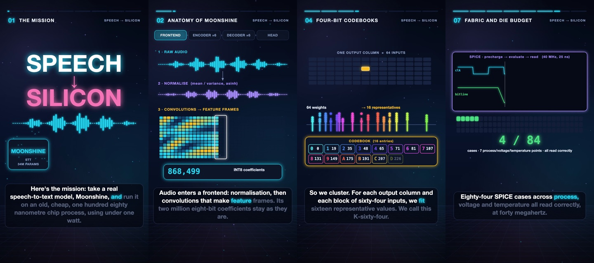](https://raw.githubusercontent.com/sanjuhs/routevoice/main/docs/media/speech-to-silicon-explainer.mp4)

### [▶ Play the full explainer — 5 min 16 sec](https://raw.githubusercontent.com/sanjuhs/routevoice/main/docs/media/speech-to-silicon-explainer.mp4)

**Narrated · vertical video · MP4 · approximately 15.4 MiB**

[Open the video file on GitHub](docs/media/speech-to-silicon-explainer.mp4)

The explainer walks through eight chapters:

1. **The mission** — make a small speech model a dedicated piece of hardware.
2. **Inside Moonshine** — raw audio, the learned frontend, encoder and decoder.
3. **The Taalas idea** — why fixed weights change the hardware problem.
4. **Four-bit codebooks** — how 64 weights share 16 representative values.
5. **The RTL engine** — selections, shared products and accumulation.
6. **Synthesis** — turning a hardware description into gates.
7. **Weight fabric and die budget** — where the model lives physically.
8. **The scorecard** — what had been demonstrated and what remained open.

*Recorded on 29 September 2026, before the final engine routing and antenna closure. Its scorecard is a historical snapshot; use the October results below for the current release status.*

## The live experience in screenshots

These are **actual screenshots of [routing-module-180.vercel.app](https://routing-module-180.vercel.app)**, captured on 28 October 2026 at a 1440 × 1050 desktop viewport. Click any image to open its page. The interface is part of the delivered experience; the hardware evidence remains in the separate results sections.

<table>
<tr>
<td width="50%"><a href="https://routing-module-180.vercel.app">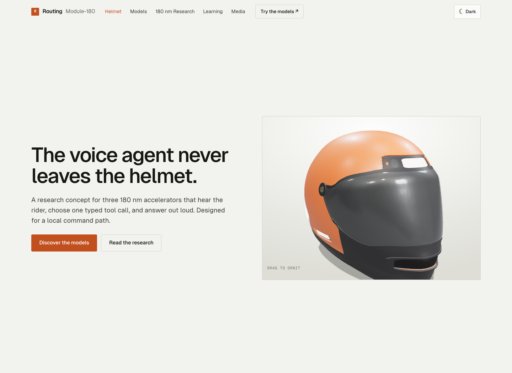</a></td>
<td width="50%"><a href="https://routing-module-180.vercel.app/models">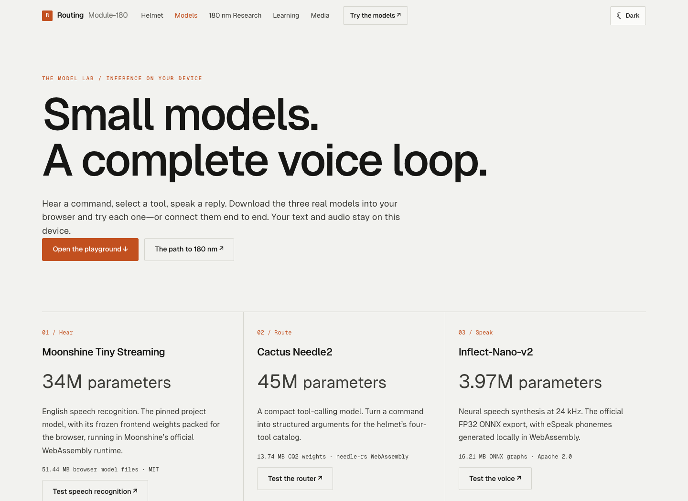</a></td>
</tr>
<tr><td><b>The product.</b> A 3D helmet and the local voice-agent story.</td><td><b>The model stack.</b> Speech recognition, typed tool routing and voice output.</td></tr>
<tr>
<td><a href="https://routing-module-180.vercel.app/research">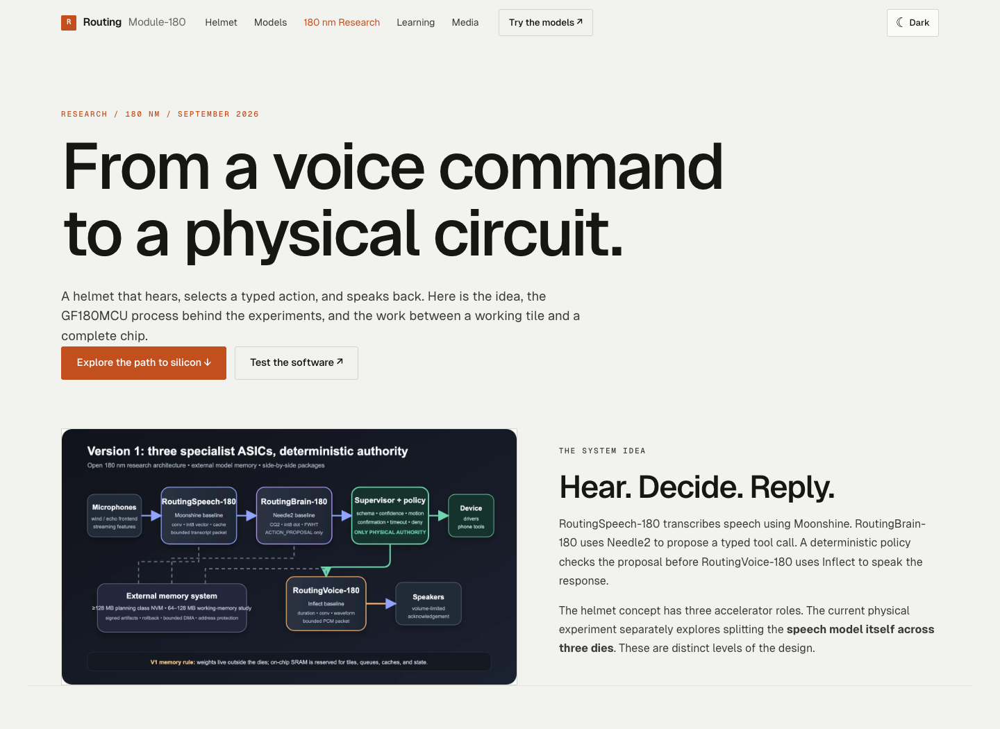</a></td>
<td><a href="https://routing-module-180.vercel.app/media">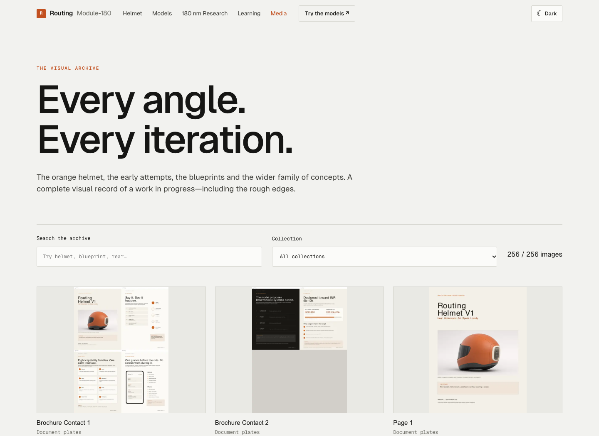</a></td>
</tr>
<tr><td><b>The engineering context.</b> Research direction, evidence and roadmap.</td><td><b>The visual library.</b> Product concepts and engineering imagery.</td></tr>
<tr>
<td><a href="https://routing-module-180.vercel.app/learning">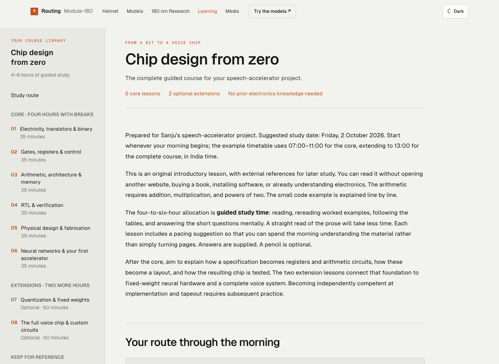</a></td>
<td><a href="https://routing-module-180.vercel.app/models#playground">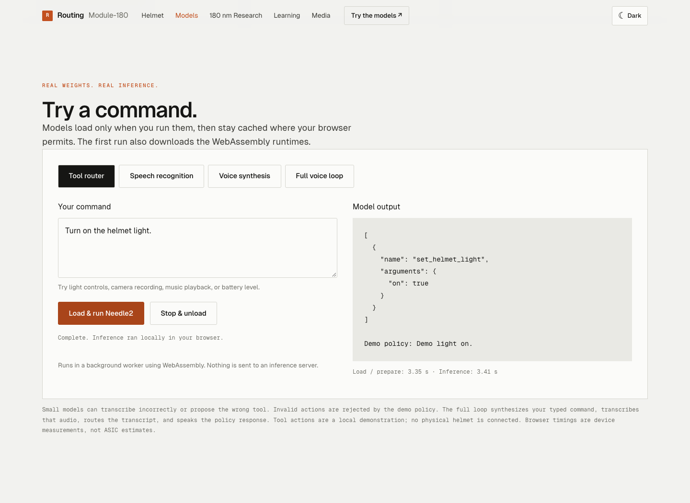</a></td>
</tr>
<tr><td><b>The learning material.</b> Eight lessons take readers from chip fundamentals into the flow.</td><td><b>The working interface.</b> A browser inference run for “Turn on the helmet light.”</td></tr>
</table>

[Capture metadata and recorded playground output](docs/media/milestone/screenshots.json) preserve the context of these images. Screenshots are a presentation record, not a new model-accuracy evaluation.

## The original vision: a voice module for helmets

<table>
<tr>
<td width="38%"><a href="https://routing-module-180.vercel.app">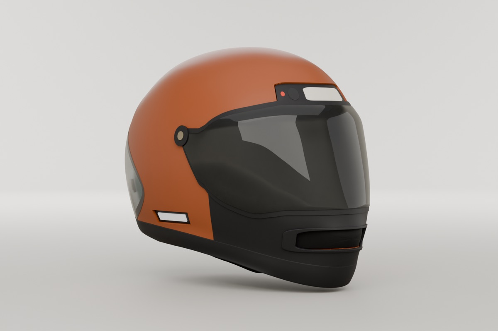</a></td>
<td width="62%">
<h3>Hear. Route. Act. Speak.</h3>
<p>A rider gives a short command. Speech recognition turns it into text; a small routing model proposes a tool call; deterministic policy checks the request; the device executes an allowed action and speaks a short reply.</p>
<p>The concept explores hands-free lights, camera, music, recording and navigation interactions. Safety-relevant decisions belong to deterministic control logic.</p>
<p><a href="https://routing-module-180.vercel.app"><b>Explore the interactive helmet website →</b></a></p>
</td>
</tr>
</table>

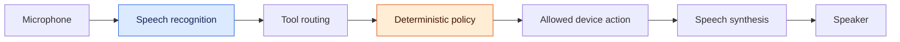

**RouteVoice's hardware work focuses on the speech-recognition block.** The wider helmet project explores the complete local-agent experience, including a paired phone for network-dependent services. The original three-function product concept and the current recognizer's chip-integration study are different levels of the project.

On the website you can orbit the helmet, follow a command through the staged visualization, and open the browser model playground. The playground uses Moonshine for recognition, Needle2 for tool routing, and Inflect for speech synthesis; model assets download before local browser inference. Tool actions are demonstrations, with validation before mock execution.

The helmet images are concept renders. The product animation illustrates the intended interaction, and browser timings describe the browser's device. Neither is a fabricated-hardware demonstration or an ASIC performance measurement.

## Design work: from concept to assembly

The design effort explored how a local voice agent could feel as a physical object: where the microphones sit, how recording is made visible, how a rider cancels an action, and how electronics remain serviceable. It progressed from exterior concepts and placement diagrams to a reference-fitted Blender model and a portable web assembly.

### Exterior, packaging and cutaway studies

<table>
<tr>
<td width="50%">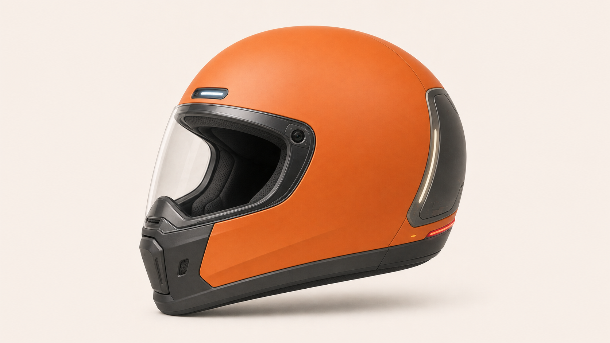</td>
<td width="50%">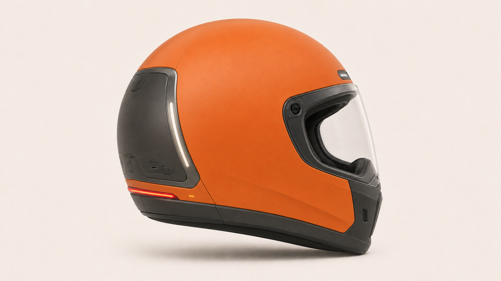</td>
</tr>
<tr><td><b>Front-left concept.</b> The visor, lighting and camera placement are part of one product form.</td><td><b>Rear-right concept.</b> The removable rear module gives compute, power and service access a defined home.</td></tr>
<tr>
<td>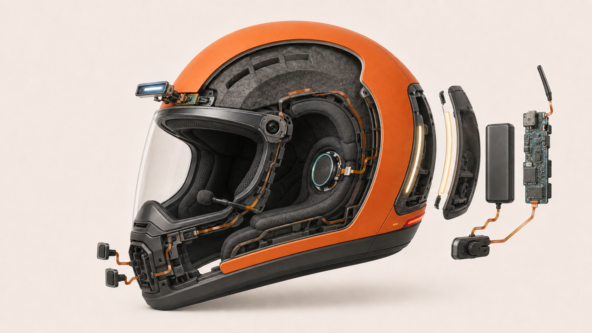</td>
<td>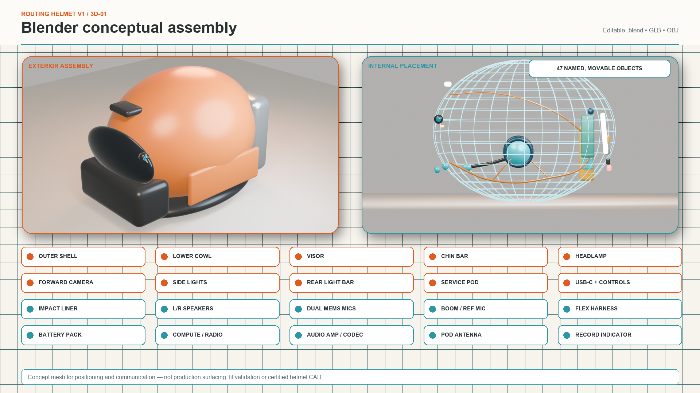</td>
</tr>
<tr><td><b>Packaging study.</b> Internal placement connects the exterior design to the system story.</td><td><b>Assembly study.</b> Individually named parts make the concept inspectable and reusable in the web experience.</td></tr>
</table>

### Placement, audio and controls

<table>
<tr>
<td width="50%">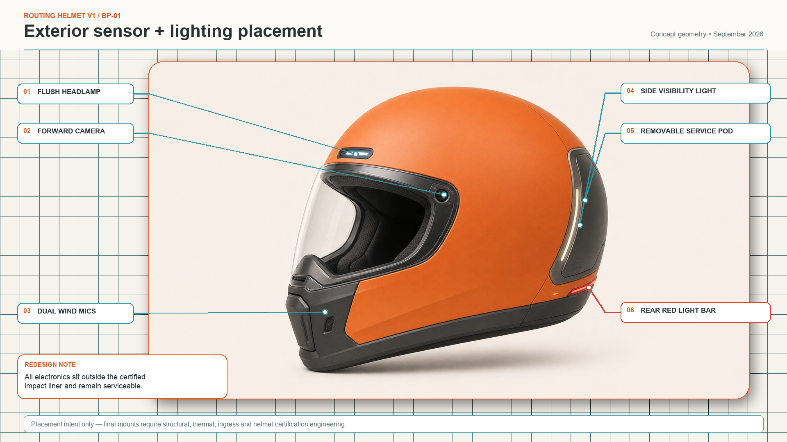</td>
<td width="50%">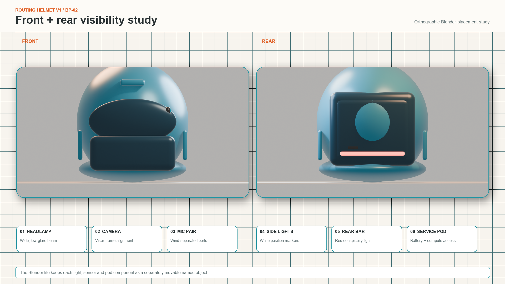</td>
</tr>
<tr><td><b>Exterior interfaces.</b> Camera, lighting and sensing are explicitly placed.</td><td><b>Visibility study.</b> Front and rear views expose the intended arrangement.</td></tr>
</table>

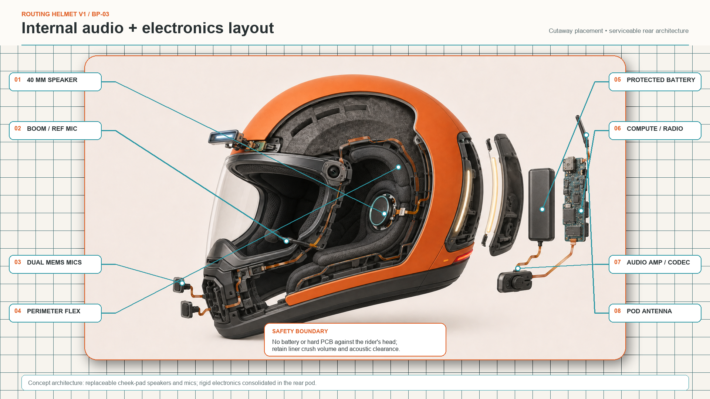

The audio study covers wind-separated chin microphones, a reference microphone, replaceable speakers and the perimeter harness. The product definition puts permission, confirmation, physical cancel, and safe failure under deterministic supervision. Emergency, battery, thermal and hearing-protection behavior is independent of the language model.

### V4: the fitted Blender model

<table>
<tr>
<td width="50%">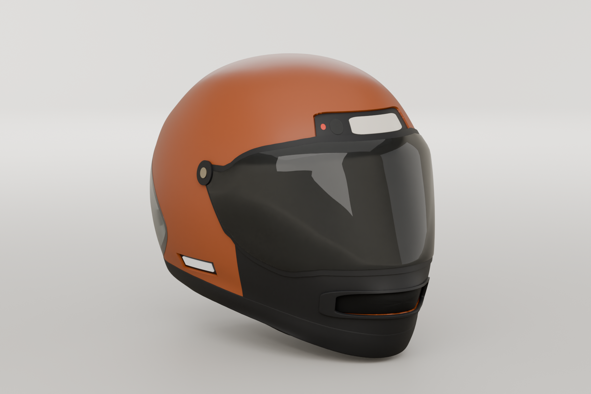</td>
<td width="50%">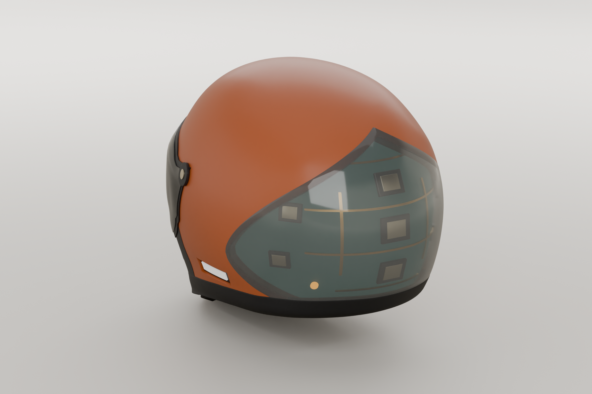</td>
</tr>
<tr><td><b>V4 front view.</b> The shell was fitted against a reconstructed reference surface.</td><td><b>V4 rear view.</b> The fitted shell carries the pod, lighting and component arrangement.</td></tr>
<tr>
<td>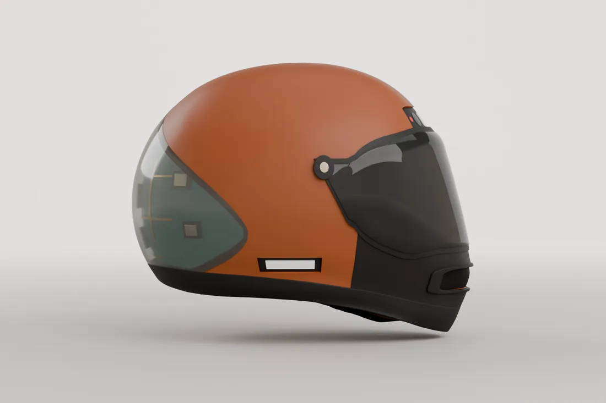</td>
<td>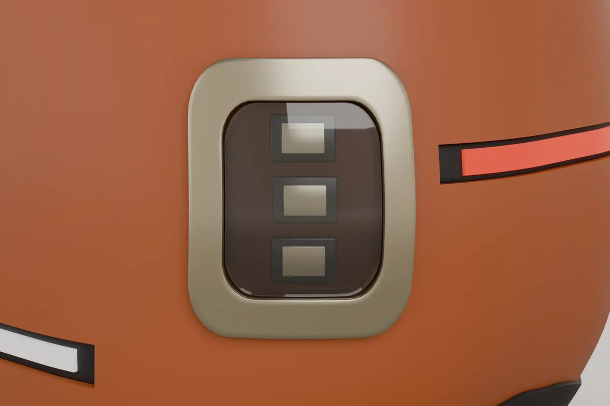</td>
</tr>
<tr><td><b>Profile study.</b> A supporting render used in the website.</td><td><b>Pod detail.</b> A supporting packaging view from the earlier render set.</td></tr>
</table>

The saved [reference-fit score](docs/milestone-evidence/helmet-reference-fit-score.json) reports **2.07 mm RMS** error at **77.5% coverage** against that reconstructed reference. This measures agreement with concept-derived geometry, not head fit, impact performance or manufacturing tolerances. The optimized web GLB preserves the 49 named parts used by the site's component-level animation.

**Design deliverables preserved here:** [14-page product brief](docs/design/Routing-Helmet-V1-Product-Brief.pdf) · [6-page brochure](docs/design/Routing-Helmet-V1-Brochure.pdf) · [portable V4 web model, GLB](docs/design/Routing-Helmet-V4-Web.glb) · [26 typed product proposals](docs/milestone-evidence/helmet-tool-catalog-v1.json).

The documents retain their September 2026 product-planning context, including illustrative cost targets and earlier render choices. The diagrams and models are design/storytelling artifacts, not manufacturing drawings or certification evidence. Original-source paths and SHA-256 checksums are recorded in the [asset provenance manifest](docs/milestone-evidence/asset-provenance.json).

## Full-stack report

The project contains several different kinds of completion. This inventory distinguishes a delivered design or software artifact from an RTL proof, a physical block result, and an unfinished integrated product.

| Layer | Work completed in this milestone | Delivered evidence | Boundary for the next phase |
|---|---|---|---|
| **Product and interaction** | Voice-first use cases, local/phone split, 26 typed proposals, policy and cancellation model | [Product brief](docs/design/Routing-Helmet-V1-Product-Brief.pdf), [tool catalog](docs/milestone-evidence/helmet-tool-catalog-v1.json) | Requirements and design; physical dispatch and product validation remain |
| **Industrial design** | Exterior concepts, cutaways, sensor/audio placement, Blender assembly and V4 reference fitting | [Design gallery](#design-work-from-concept-to-assembly), [GLB](docs/design/Routing-Helmet-V4-Web.glb), [fit score](docs/milestone-evidence/helmet-reference-fit-score.json) | Concept geometry; mechanical, acoustic and safety qualification remain |
| **Public experience** | Five website routes, orbitable helmet, staged command visualization, model lab, media gallery and learning course | [Live website](https://routing-module-180.vercel.app), [screenshots](#the-live-experience-in-screenshots) | Web demonstration; no physical helmet is connected |
| **Speech and agent software** | Moonshine STT, Needle2 tool proposals, deterministic demo validation, Inflect TTS and a browser pipeline | [Browser lab](https://routing-module-180.vercel.app/models), [saved September smoke results](docs/milestone-evidence/browser-verification-2026-09-08.json) | Browser/host execution; router and TTS are not complete fabricated accelerators |
| **Numerical model** | K64 codebook representation, frozen coefficients, reserved quality evaluation and exact reconstruction checks | [Representation and evaluation](paper/sections/representation.tex), [W11 storage/roundtrip evidence](routing-voice-chip-design/overnight-20261014/finish-1023/w11-taalas-e2e/RESULTS.md) | Hardware parity is to the frozen K64 model; broader quality validation remains |
| **Datapath architecture** | Shared partial products, 320 accumulation lanes, affine output stages, locality and pipeline fixes | [Engine contract](routing-voice-chip-design/overnight-20261014/fabric-k64/CONTRACT.md), [final engine report](routing-voice-chip-design/overnight-20261014/finish-1023/w10-route/pipe2/README.md) | A projection engine is one part of the whole streaming service |
| **Recognizer RTL** | Learned frontend, six encoder layers, cross-attention services and six-layer greedy decoder; three bit-exact demonstrations | [W11 results](routing-voice-chip-design/overnight-20261014/finish-1023/w11-taalas-e2e/RESULTS.md), [demo clips and logs](routing-voice-chip-design/release-v1/demo/) | Functional simulation; complete physical timing and real-time behavior remain |
| **Weight fabric** | 98 matrices packed into 81 physical banks; layout readback, selected DRC, representative LVS and tool-view checks | [W13 results](routing-voice-chip-design/overnight-20261014/finish-1023/w13-arrays/RESULTS.md) | Research macro handoff; periphery, full characterization and chip integration remain |
| **Synthesis and state** | Whole-recognizer synthesis exposed the cost of flip-flop state and FPGA resource demand | [W12 synthesis](routing-voice-chip-design/overnight-20261014/finish-1023/w12-synth/RESULTS.md), [FPGA capacity](routing-voice-chip-design/overnight-20261014/finish-1023/w12-synth/FPGA-CAPACITY.md) | Resource accounting is complete; a practical SRAM-backed implementation is still needed |
| **Physical implementation** | Projection engine routed; antenna closed; recorded DRC/LVS/XOR clean; setup and hold closed at nine corners | [Signoff table](routing-voice-chip-design/release-v1/figures/signoff-table.md), [final engine evidence](routing-voice-chip-design/overnight-20261014/finish-1023/w10-route/pipe2/evidence-ant/) | Open-flow block result; electrical-limit warnings and full-chip closure remain |
| **Integration study** | Floorplans, macro placement, control/state bridges and partial two-die routing explored | [Architecture](paper/sections/architecture.tex), [dated lab log](OVERNIGHT-PROGRESS.md) | Full-chip DRC/LVS, timing, power integrity and scheduling remain |
| **Communication and preservation** | Paper, eight-chapter explainer, RTL replay, layout zooms, scaling figures, design documents and checksummed archives | [Paper](paper/), [video](#watch-speech--silicon), [release package](routing-voice-chip-design/release-v1/), [archives](#repository-map-and-archives) | A documented baseline for independent review and subsequent work |

### The software and policy path

**Speech in.** Moonshine Tiny Streaming supplies the speech-recognition reference. The browser version runs through WebAssembly; the hardware branch studies its frozen K64 representation. These are related implementations with different numerical and execution contexts.

**Intent to proposal.** Needle2 supplies bounded tool routing. The broader product definition contains 26 typed proposals; the public browser demonstration uses a deliberately smaller four-tool policy. A model proposal is checked before mock execution. It does not directly acquire device authority.

**Reply out.** Inflect-Nano-v2 generates the voice reply in the software/browser experience. Its browser frontend uses eSpeak phonemization and ONNX Runtime Web; its normalization and noise handling are not claimed to be numerically identical to the Python frontend.

**Runtime separation.** Browser models run in a dedicated worker with lazy asset loading and caching. Stopping unloads the worker. The helmet visualization runs through three.js and a compressed GLB; Python/native-model experiments and Verilator/EDA runs belong to the research environment. No browser timing is presented as chip performance.

The preserved [8 September browser smoke record](docs/milestone-evidence/browser-verification-2026-09-08.json) includes successful STT, routing, TTS and pipeline calls, media search/lightbox checks and a 390-pixel mobile-layout check. It also retains a malformed routing response and the fact that physical microphone permission/audio were not exercised. This is dated functional evidence, not a fresh benchmark or a reliability rate.

### What made the hardware work difficult

The central challenges were visible across abstraction boundaries. Smaller coefficient payloads did not automatically yield a small chip. Shared arithmetic did not automatically yield easy routing. Meeting a dense MAC estimate did not automatically meet a streaming deadline.

The engine's long, high-fanout connections required local partial-product registers and a split output-selection path. An extra preparation state and pipeline registers increased the final projection from 4,163 to 4,165 cycles while allowing slow-corner closure. Antenna repair then progressed from 199 affected nets through ten repair rounds to zero. The full-recognizer synthesis separately exposed the area of mutable state, motivating SRAM integration for the next phase.

Those lessons are part of the milestone: the project records the implemented fixes, the measured consequences, and the remaining constraints in the [closure report](routing-voice-chip-design/overnight-20261014/finish-1023/w10-route/pipe2/README.md) and [paper](paper/RouteVoice-paper-draft.pdf).

## See the hardware model transcribe real audio

[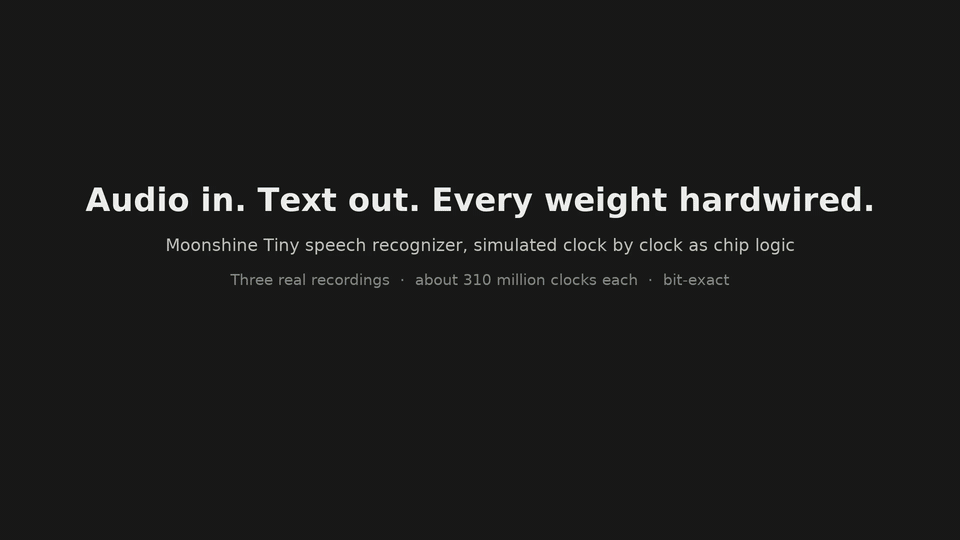](https://raw.githubusercontent.com/sanjuhs/routevoice/main/routing-voice-chip-design/release-v1/demo/routevoice-demo.mp4)

**[▶ Watch the 34-second demo with audio](https://raw.githubusercontent.com/sanjuhs/routevoice/main/routing-voice-chip-design/release-v1/demo/routevoice-demo.mp4)** · [Audio clips and checksums](routing-voice-chip-design/release-v1/demo/clips/) · [Recorded simulation logs](routing-voice-chip-design/release-v1/demo/logs/)

| Input recording | Duration | RTL transcript | Common clocks | Reference comparison |
|---|---:|---|---:|---|
| [Wispr 007, segment 0](routing-voice-chip-design/release-v1/demo/clips/01-switch-on-the-lights.wav) | 1.28 s | “Switch on the lights” | 312,578,649 | 18/18 internal outputs bit-identical |
| [Wispr 031, segment 1](routing-voice-chip-design/release-v1/demo/clips/02-plant-present.wav) | 1.28 s | “Plant present.” | 309,272,913 | 18/18 internal outputs bit-identical |
| [LibriSpeech dev-clean segment](routing-voice-chip-design/release-v1/demo/clips/03-seasonable.wav) | 1.22 s | “Seasonable.” | 308,976,820 | 18/18 internal outputs bit-identical |

These are replays of Verilator runs recorded on 21 October. Each simulation took roughly an hour. The animation follows logged milestones and counters, compressed into a short presentation; it does not show real-time recognition. The WAV files are the PCM consumed by the RTL, with hashes recorded in the [clip manifest](routing-voice-chip-design/release-v1/demo/clips/clips.json).

**Bit-exact means agreement with the frozen K64 model.** It does not mean unchanged weights relative to the original Moonshine model, perfect transcription on arbitrary speech, or validated performance in helmet acoustics.

## How the model becomes hardware

### 1. Represent the weights with local codebooks

For each output column, groups of 64 input weights share a book of 16 eight-bit representative values. Each weight becomes a **four-bit selection** into that book. This format is called **K64**.

```text
64 input weights for one output column
                │
                ├── 16 representative UINT8 values → the codebook
                └── 64 four-bit indices            → the selections
```

A four-bit index is an address into a book, not a claim that the entire model's arithmetic is four-bit. Zero points, scales, biases and activation precision retain their separate roles. The frontend preserves its signed INT8 coefficients and FP32 metadata; it is not simply converted into the same four-bit format.

### 2. Reuse partial products across output lanes

For an input activation `a`, the engine forms `a × 0` through `a × 15`. An eight-bit representative `w` can be split into two nibbles:

```text
w = 16 × high + low

a × w = (a × high) × 16 + (a × low)
```

The output lanes select from shared products, shift and add. The final engine handles a **1280 × 320 projection: 409,600 multiply-accumulates in 4,165 cycles**. Zero-point correction and FP32 scaling/bias follow the model's numerical contract.

### 3. Encode selections in the layout

The physical weight banks represent each selection with four mask-programmed bit cells. **Via1 connection positions encode the bits.** Readback checks compare the patterns in the GDS with the packed model.

Across the released fabric, **98 matrices map to 81 physical banks**, containing **31,457,280 four-bit selections**. The codebooks and other constants are fixed in the present RTL. Activations, attention state and decoder caches remain mutable and require working memory.

### 4. Connect the recognizer and verify each boundary

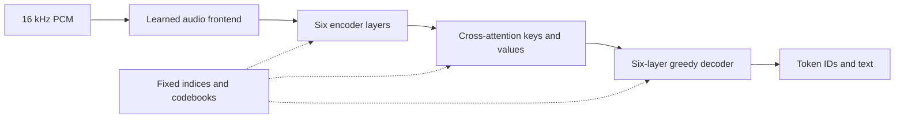

The functional proof runs audio through the complete recognizer on one common clock. The physical-design proof separately lays out the projection engine and weight banks. Joining those pieces into a fully verified chip is still an integration task.

For the details, read the paper's [weight representation](paper/sections/representation.tex), [architecture](paper/sections/architecture.tex), and the [engine contract](routing-voice-chip-design/overnight-20261014/fabric-k64/CONTRACT.md). The shared-product approach draws on public Taalas patent disclosures; RouteVoice is an independent implementation, with the sources collected in the [paper bibliography](paper/refs.bib).

## Results and evidence

| Area | Recorded result | Scope and source |
|---|---|---|
| **Complete recognizer RTL** | Three audio clips; 18/18 internal outputs match on each | Frozen K64 reference; [W11 evidence](routing-voice-chip-design/overnight-20261014/finish-1023/w11-taalas-e2e/RESULTS.md) and [demo logs](routing-voice-chip-design/release-v1/demo/logs/) |
| **Converted service payloads** | 28,641,280 → 17,497,600 bytes; **38.91% reduction** | Seven converted services; **26,344,960 bytes** including five unchanged large tables, before small LUTs and mutable state; [storage accounting](routing-voice-chip-design/overnight-20261014/finish-1023/w11-taalas-e2e/RESULTS.md#representation-and-storage) |
| **Weight fabric** | 31.46 M selections in **174.71 mm²** across 81 banks | Layout area includes readout/local metal, excludes external periphery; selected DRC and readback 81/81, full LVS on six named banks; [W13 results](routing-voice-chip-design/overnight-20261014/finish-1023/w13-arrays/RESULTS.md) |
| **Projection engine layout** | **22.84 mm²**, 1,146,232 standard cells, 68.9 m of wire | One routed engine, excluding the index bank; [final engine report](routing-voice-chip-design/overnight-20261014/finish-1023/w10-route/pipe2/README.md#antenna-close-out-24-oct-evening-final-signoff) |
| **Engine physical checks** | Routing/Magic/KLayout DRC **0**; LVS unique match; GDS XOR **0**; antenna **0** | Open GF180 flow; [signoff table](routing-voice-chip-design/release-v1/figures/signoff-table.md) |
| **Engine timing** | **150 ns** target; setup and hold met at **9/9** checked PVT/RC corners | Worst setup **+8.10 ns**, worst hold **+0.324 ns**; [final engine report](routing-voice-chip-design/overnight-20261014/finish-1023/w10-route/pipe2/README.md) |
| **Engine power estimate** | **0.188 W**, approximately **117 µJ/projection**, **287 pJ/MAC** | Routed estimate from one real-speech projection; 67.5% pin activity annotation, zero-delay simulation; [power methodology](routing-voice-chip-design/overnight-20261014/finish-1023/w10-route/pipe2/README.md#activity-annotated-routed-power) |

The storage figures describe logical payloads, the layout figures describe specific physical blocks, and the power figure is a tool estimate. They are not interchangeable measures of full-chip cost or efficiency.

### Recognition quality after K64 conversion

The reserved software evaluation used **80 utterances from 40 held-out speakers**, with clean, “other”, and 10 dB white-noise conditions. It is separate from the three RTL demonstration clips.

| Condition | K64 word error rate | Change from the original model |
|---|---:|---:|
| Clean | 4.49% | +0.23 percentage points |
| Other | 13.63% | +0.89 percentage points |
| Noise, 10 dB | 15.77% | +1.84 percentage points |

The point estimates passed the declared gates. Confidence intervals for “other” and noisy speech extend beyond the +2-point degradation gate, so this small test does not establish a population guarantee or real-road helmet accuracy. See the [paper’s quality results and evaluation details](paper/sections/representation.tex).

## Inside the silicon

<table>
<tr>
<td width="50%">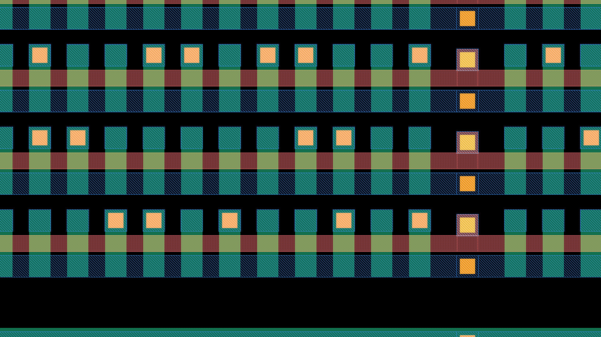</td>
<td width="50%">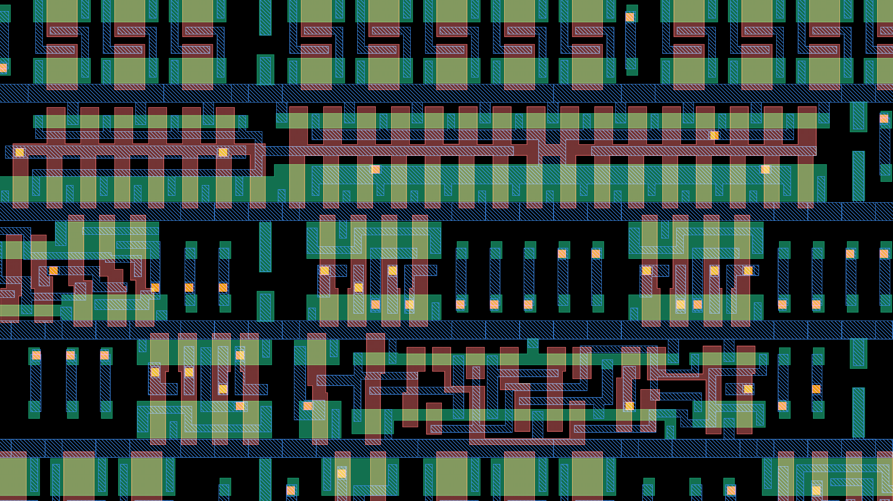</td>
</tr>
<tr>
<td><b>The model, encoded in metal.</b> The regular cell grid carries an irregular pattern of Via1 connections: the fixed four-bit selections.</td>
<td><b>The compute engine.</b> Standard cells and routing implement the shared-product selection and accumulation datapath.</td>
</tr>
<tr>
<td></td>
<td>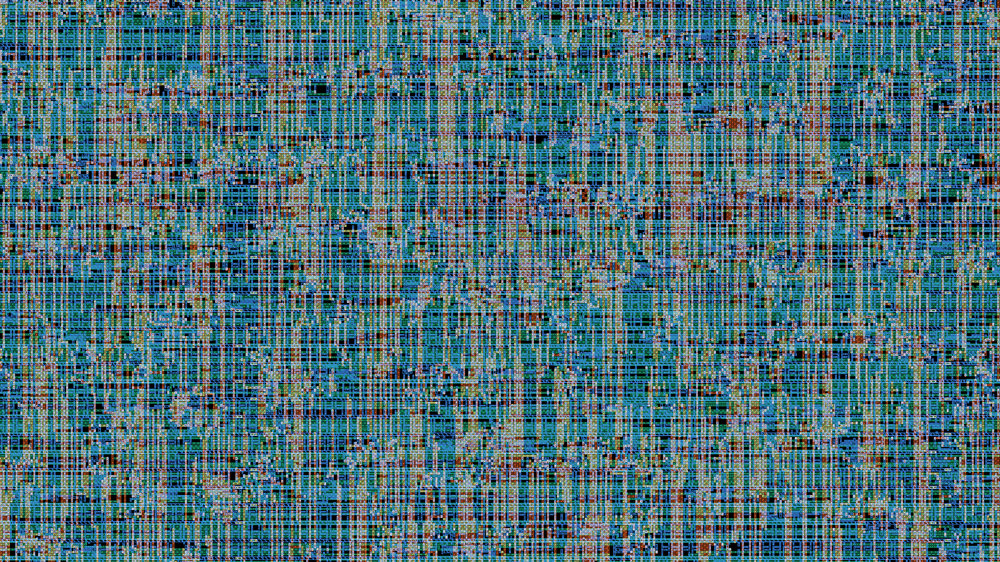</td>
</tr>
<tr>
<td>One bank: 409,600 four-bit selections in approximately 2.27 mm².</td>
<td>The routed engine: 22.84 mm², with 68.9 metres of wire.</td>
</tr>
</table>

<table>
<tr>
<td width="50%"></td>
<td width="50%">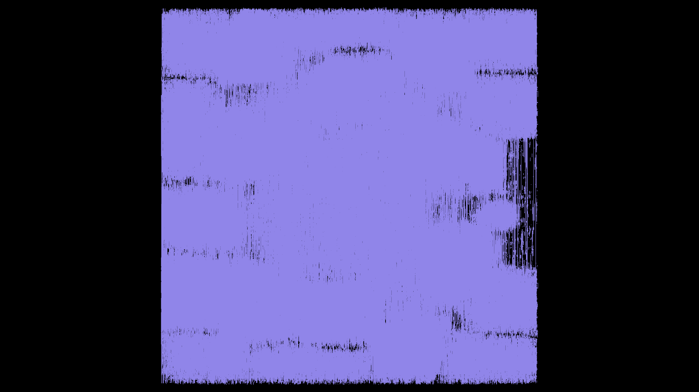</td>
</tr>
<tr><td><b>Full bank.</b> A physical macro that stores a slice of the model.</td><td><b>Full engine.</b> The die-scale view connects the close-ups to the implemented block.</td></tr>
</table>

These are renders of layout data, not microscope photographs. Explore the [full zoom sequences](routing-voice-chip-design/release-v1/figures/layout/).

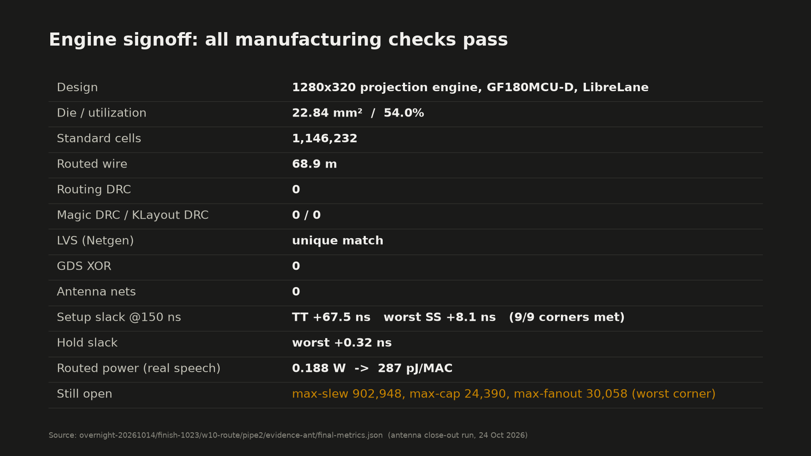

## From a speech model to larger local models

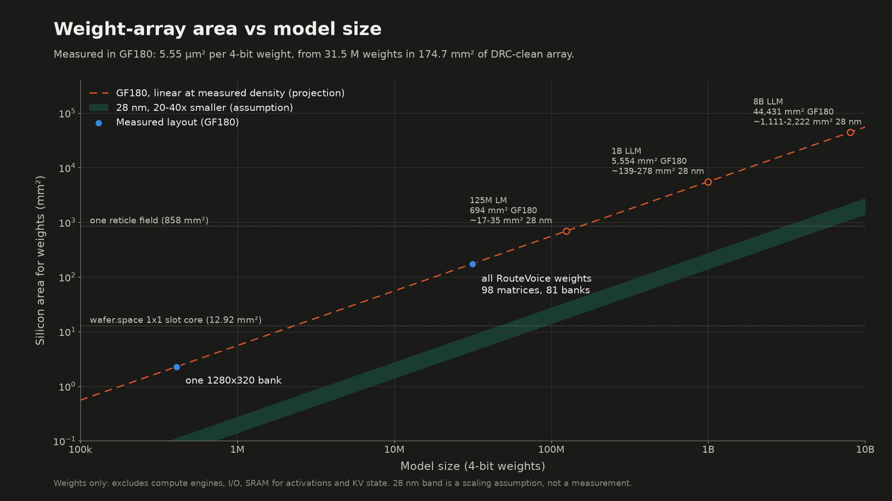

The physical banks provide a measured layout density of approximately **5.55 µm² per four-bit selection**, including local readout. Extending that density gives about **5,500 mm² of weight-array area for a one-billion-parameter model at 180 nm**. A hypothetical 20–40× reduction at 28 nm would bring that to roughly **140–280 mm²**.

Those are **weight-array projections**, excluding compute engines, activation/KV memory, I/O and integration overhead. The 28 nm band is an assumption, not a fabricated result. The [energy chart](routing-voice-chip-design/release-v1/figures/scaling-energy.png), [underlying CSV](routing-voice-chip-design/release-v1/figures/scaling-data.csv), and [future-scope discussion](paper/sections/future.tex) make the assumptions explicit.

The longer-term goal is a useful local voice loop: speech recognition, a small routing or language model, and speech synthesis. Hardwired model storage addresses only part of that problem; scheduling, mutable state, acoustics and update strategy still matter.

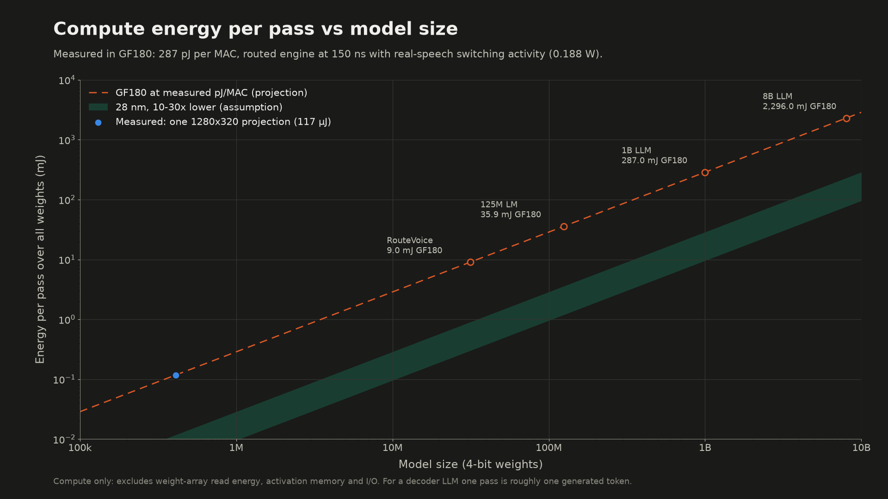

### Beyond the helmet: the original product horizon

<table>
<tr>
<td width="50%">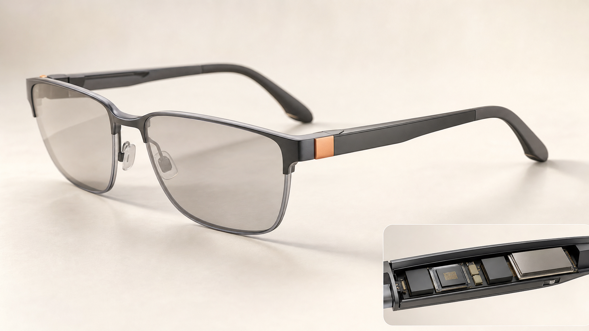</td>
<td width="50%">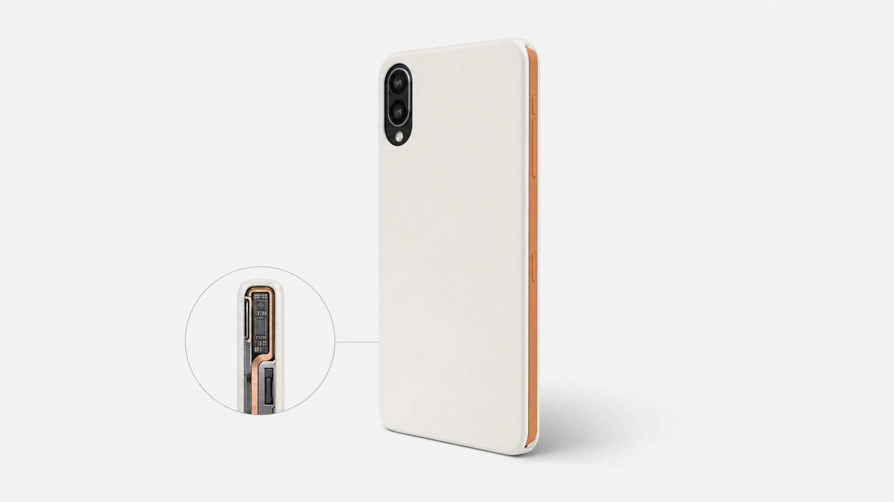</td>
</tr>
<tr><td><b>Glasses.</b> A wearable direction from the original concept campaign.</td><td><b>Phone sidecar.</b> A local-compute accessory direction from the same campaign.</td></tr>
</table>

These images preserve the broader motivation behind the helmet study: local voice interfaces in everyday objects. They are speculative product concepts, not implemented hardware or verified 28 nm designs.

## How the project reached this milestone

| Period | Step in the project | What it contributed |
|---|---|---|
| **Early September 2026** | Local-agent product definition and visual campaign | The helmet use case, typed function surface, policy boundaries and broader wearable concepts |
| **September 2026 design work** | Product brief, brochure, placement sheets and V4 Blender development | A tangible system story, component-level assembly and reusable 3D/media assets |
| **8 September recorded website verification** | Browser model lab and public experience | Real model calls, a staged product walkthrough, media browsing and saved smoke evidence |
| **September architecture refinement** | Focus on the Moonshine speech recognizer and K64/shared-product hardware | A concrete numerical target and a smaller, testable hardware research scope |
| **29 September** | Speech → Silicon explainer | A narrated account of the model, codebooks, RTL, synthesis and weight fabric at that stage |
| **21 October** | Recognizer and weight-fabric results | Three bit-exact RTL demos and the 81-bank, 98-matrix physical handoff |
| **23–24 October** | Engine pipeline fixes, routed timing and antenna close-out | Nine-corner setup/hold closure, recorded clean physical checks and activity-based power estimates |
| **28 October** | Public RouteVoice snapshot and milestone report | Paper, videos, design artifacts, website captures, evidence index and next-phase handoff in one repository |

The [lab log](OVERNIGHT-PROGRESS.md) retains the detailed chronology, including earlier failures and superseded numbers. The final engine report and release tables take precedence over older intermediate results.

## Run the recorded demo locally

No EDA installation or model download is needed for the terminal replay. Use Git and Python 3:

```bash
git clone https://github.com/sanjuhs/routevoice.git
cd routevoice

# Replay one recorded clip quickly.
python3 routing-voice-chip-design/release-v1/demo/replay.py --clip 1 --seconds 5

# Replay all three recorded clips.
python3 routing-voice-chip-design/release-v1/demo/replay.py

# On macOS, also play the original WAV files through afplay.
python3 routing-voice-chip-design/release-v1/demo/replay.py --play
```

The replay reads committed logs and comparison receipts. It does not compile RTL or run a new inference. For immediate model interaction, use the [browser playground](https://routing-module-180.vercel.app/models).

### Reproduce the engineering work

| Task | Entry point | Requirements and boundaries |
|---|---|---|
| Inspect the result | [Release package](routing-voice-chip-design/release-v1/README.md) | Figures, WAV files, logs and tables are in this repository |
| Trace numerical correctness | [W11 results and recorded commands](routing-voice-chip-design/overnight-20261014/finish-1023/w11-taalas-e2e/RESULTS.md) | Verilator, pinned model fixtures/ROMs, and restoration of the original run inputs |
| Inspect or rerun engine closure | [Final engine flow](routing-voice-chip-design/overnight-20261014/finish-1023/w10-route/pipe2/README.md) | Open EDA tools, GF180MCU-D PDK, flow configuration and archived run data |
| Rebuild layout images and charts | [Figure-generation instructions](routing-voice-chip-design/release-v1/README.md#rebuilding-the-figures) | Python dependencies; GDS archives for layout renders; FFmpeg/Pillow for video |
| Build the paper | [Paper README](paper/README.md) | Tectonic and the LaTeX sources |

This is a **research snapshot**, not a portable one-command tapeout flow. Some scripts retain absolute paths from the original machines, and large run directories, PDKs and model inputs are not all bundled in Git. Check each task's documented prerequisites before starting an expensive run.

## Repository map and archives

| Location | Contents |
|---|---|
| [`routing-voice-chip-design/release-v1/`](routing-voice-chip-design/release-v1/) | Curated release: demo, layout images, signoff table, scaling data and generation scripts |
| [`routing-voice-chip-design/rtl/`](routing-voice-chip-design/rtl/) | Hardware descriptions |
| [`routing-voice-chip-design/scripts/`](routing-voice-chip-design/scripts/) · [`tests/`](routing-voice-chip-design/tests/) | Generators, checks and verification tooling |
| [`routing-voice-chip-design/physical/`](routing-voice-chip-design/physical/) | Physical-design inputs |
| [`routing-voice-chip-design/overnight-20261014/finish-1023/`](routing-voice-chip-design/overnight-20261014/finish-1023/) | Dated engine, recognizer, synthesis and weight-array evidence |
| [`routing-voice-chip-design/docs/`](routing-voice-chip-design/docs/) · [`reports/`](routing-voice-chip-design/reports/) | Design notes, proof gates, quality results and audit records |
| [`paper/`](paper/) | Research-paper PDF, LaTeX, bibliography, figures and notes |
| [`docs/media/`](docs/media/) | Explainer MP4, poster, website screenshots and the expanded design gallery |
| [`docs/design/`](docs/design/) | Original product brief, brochure and portable V4 web GLB |
| [`docs/milestone-evidence/`](docs/milestone-evidence/) | Product tool catalog, dated browser checks, fit score and asset provenance |
| [`OVERNIGHT-PROGRESS.md`](OVERNIGHT-PROGRESS.md) | Chronological lab log, including integration work and unresolved items |

Large artifacts live in public Hugging Face datasets:

| Archive | Contents |
|---|---|
| [**routevoice-engine-fix2-20261024**](https://huggingface.co/datasets/sanjuhs/routevoice-engine-fix2-20261024) | Approximately 97 GB of engine runs: fix 2, antenna close-out, final GDS and checksum manifests |
| [**routevoice-pod-final-20261022**](https://huggingface.co/datasets/sanjuhs/routevoice-pod-final-20261022) | Approximately 53 GB of cloud workspace, with archive and restoration metadata |

The public repository was extracted from the larger working project on 28 October 2026. Some historical documents refer to files outside this curated snapshot. Use the release package and archive manifests to locate available evidence.

## What remains to be built

- **SRAM-backed mutable state.** The full recognizer synthesis is about 1,198 mm² of GF180 logic with approximately 8.17 M mutable bits implemented as flip-flops. Mapping state into SRAM is a major area task.
- **Complete chip integration.** The two-die study is partly integrated. Full-chip DRC/LVS, timing, drivers and power integrity still need closure; assumed-load IR-drop checks expose unresolved limits.
- **Real-time scheduling.** The engine's throughput alone does not establish real-time recognition. The streaming controller reprocesses frames and regenerates cross-attention state; scheduling and reuse need further work.
- **Electrical closure.** The final engine still reports worst-corner max-slew, max-capacitance and max-fanout violations. Passing setup/hold and the listed physical checks does not close those items.
- **Broader validation.** Live streaming, road/wind/helmet acoustics and more held-out speakers need evaluation. The short RTL examples establish implementation agreement, not field reliability.
- **Fabrication and measurement.** Foundry review, tapeout, packaging, board bring-up and measured power/performance remain future work.

The [release limitations](routing-voice-chip-design/release-v1/README.md#what-is-not-done) and [paper](paper/RouteVoice-paper-draft.pdf) provide further context. Useful contributions include portable reproduction tooling, SRAM integration, scheduling, electrical cleanup and independently repeatable evaluations. Please include the exact design revision, input data and evidence when reporting a result.

## Handoff to the next repository

**Version 1 is the reference milestone.** Future implementation can move to a separate repository while this one remains a readable record of the product vision, numerical contracts, engineering results and known limitations. A successor repository has not been linked here yet.

| Carry forward | Why it matters | What the next phase should demonstrate |
|---|---|---|
| Frozen K64 model, fixtures and output hashes | Defines the exact numerical baseline | Preserved parity, or an explicitly versioned model change with fresh accuracy evidence |
| Projection-engine RTL, 54-vector bench and timing constraints | Preserves the block that reached routed closure | Correctness through new state/memory interfaces and physical implementation |
| Weight-bank manifests, addressing and GDS readback checks | Connects model identity to physical storage | Integrated periphery, characterization and chip-level verification |
| Mutable-state inventory and synthesis results | Makes the dominant area problem explicit | A practical SRAM mapping with matching behavior and defensible area |
| Recorded audio traces and controller behavior | Prevents dense MAC estimates from substituting for service latency | A streaming schedule with measured deadlines, state reuse and end-to-end latency |
| Product policy, audio/placement studies and browser experience | Preserves the purpose of the hardware | A physical prototype, broader acoustic testing and user-visible behavior tied to real devices |
| Evidence and artifact manifests | Makes progress comparable across repositories | Revision-linked reports, reproducible inputs and an explicit statement of what changed |

A future claim of a complete chip should add full-chip DRC/LVS, timing and power-integrity closure. A real-time claim should add an end-to-end service trace. A fabricated-product claim should add silicon/board measurements and the relevant product validation. This milestone already supplies the reference material against which those advances can be judged.

## Frequently asked questions

<details>
<summary><b>Is this a general-purpose LLM chip?</b></summary>

The implemented model is a speech recognizer. Small local language models and a complete voice assistant are future directions; the present release does not demonstrate a complete LLM assistant in silicon.

</details>

<details>
<summary><b>Can a fabricated chip download new weights?</b></summary>

The physical selection bits are mask-programmed. Changing those bits means changing the fabricated pattern. Mutable codebooks or adapters are possible research directions discussed in the paper, not demonstrated update features in this release.

</details>

<details>
<summary><b>Does 0.188 W mean the entire voice assistant is sub-watt?</b></summary>

It is the routed power estimate for one projection engine under the documented activity trace. It excludes the rest of the recognizer and the complete product. Full-system power has not been established.

</details>

<details>
<summary><b>Is the helmet available as a finished product?</b></summary>

The helmet is a concept explored through Blender models, renders and an interactive website. This repository publishes research and design evidence; it does not represent a manufactured or certified helmet module.

</details>

## Tools, authorship and license

The implementation uses **Verilator, Yosys, OpenROAD through LibreLane, Magic, KLayout and Netgen**, with the open **GF180MCU-D PDK**. AI coding agents, including Claude and Codex, were used under the author's direction. The [lab log](OVERNIGHT-PROGRESS.md) preserves the work history and evidence trail.

### Authors and contributors

| Contributor | Role |
|---|---|
| **Sanjay Prasad H S** | Project author and lead: product vision, research direction, design decisions and milestone ownership. |
| **Codex — OpenAI AI coding assistant** | AI contributor to implementation and verification under the project lead’s direction; milestone documentation, website captures, artifact checks, repository presentation and publication. |

Claude also contributed to the AI-assisted engineering work, as recorded in the lab log. See [AUTHORS.md](AUTHORS.md) for the attribution record.

This repository's own code and documents are licensed under [Apache-2.0](LICENSE). Moonshine is MIT-licensed by its authors; the PDK, third-party tools and other included materials retain their respective licenses and notices. Technical inspiration from public patent disclosures does not imply affiliation with Taalas.

---

<div align="center">

**[Explore the helmet](https://routing-module-180.vercel.app) · [Try the models](https://routing-module-180.vercel.app/models) · [Watch the explainer](#watch-speech--silicon) · [Read the paper](paper/RouteVoice-paper-draft.pdf)**

*From a spoken command to a physical design — with the evidence along the way.*

</div>
